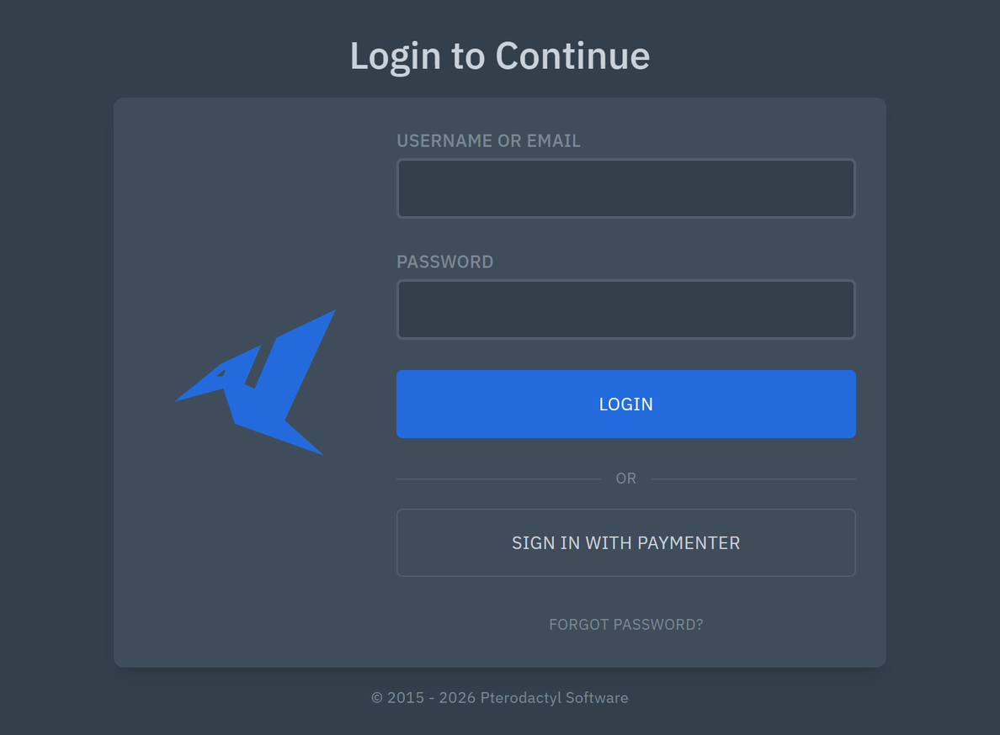
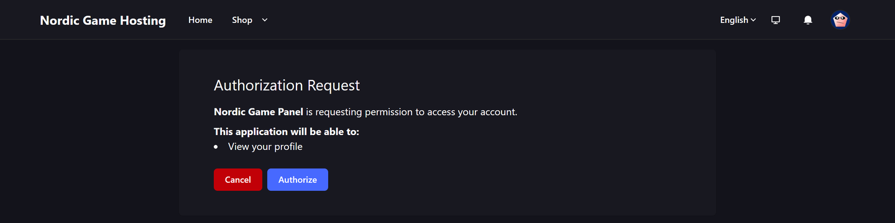
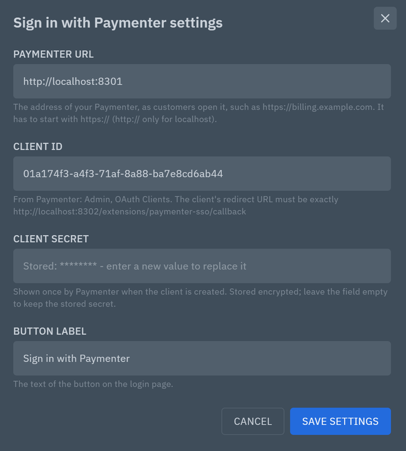
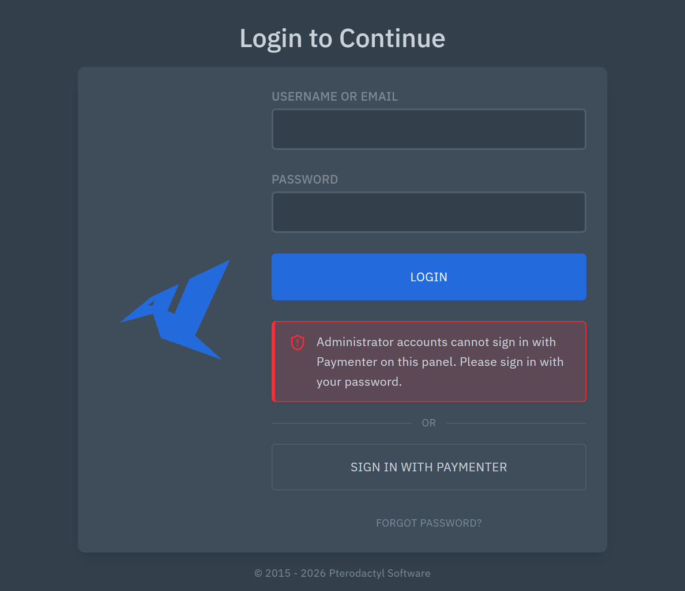

# Sign in with Paymenter for Pterodactyl 2.0

**Customers sign in to your Pterodactyl 2.0 panel with their Paymenter account.**

Sign in with Paymenter puts a **Sign in with Paymenter** button on your Pterodactyl 2.0 login page. Customers who
bought their server in your Paymenter store click it, sign in to Paymenter (or are signed in already), click
**Authorize** on Paymenter's authorization page, and land in the panel in their own account: no second password to
remember.

It uses the OAuth 2.0 server that Paymenter has built in (*Admin → OAuth Clients*), with state and PKCE, and makes
the panel session through the panel's own login code, so two-factor authentication still applies.



Version 1.0.0, by Karelia Labs. Free and open source (MIT). Tested with Pterodactyl 2.0.0-beta.2 and Paymenter 1.5.9.

Download the zip from the [GitHub releases](https://github.com/ziroxonline111/pterodactyl-paymenter-sso/releases/latest),
[SourceXchange](https://www.sourcexchange.net/products/sign-in-with-paymenter-pterodactyl-v2) or
[Gumroad](https://karelialabs.gumroad.com/l/paymenter-sso-pterodactyl). All three have the same release zip.
Website: [ziroxonline111.github.io/pterodactyl-paymenter-sso](https://ziroxonline111.github.io/pterodactyl-paymenter-sso/).

## Sign in with Paymenter and Karelia Bridge

Both are by Karelia Labs. This extension is free; Karelia Bridge is the paid one.

| | Sign in with Paymenter (this) | [Karelia Bridge](https://karelialabs.com/tools/karelia-bridge) |
|---|---|---|
| Where the customer starts | The panel's login page: a "Sign in with Paymenter" button | The service page in Paymenter: one click opens that server in the panel, already signed in |
| How it signs in | OAuth 2.0 with Paymenter's own OAuth server; the matching panel account | A one-time link from Paymenter (valid 60 seconds), straight to the right server |
| Billing in the panel | No | Billing page per server (due date, price, unpaid invoices, renew link), due-date banner and badges |
| Setup | One OAuth client in Paymenter, three settings in the panel | A Paymenter extension and a panel extension |
| Price | Free (MIT) | Paid: https://karelialabs.gumroad.com/l/karelia-bridge |

They work side by side: install both if you want the login button and the one-click links.

## Why a separate extension, and not a provider for the official SSO extension

Pterodactyl's official [SSO extension](https://github.com/pterodactyl/SSO-Extension) (MIT, version 1.2.0, a
Pterodactyl 2.0 extension) signs in with Discord, GitHub, Google, GitLab, Microsoft and Steam, and new providers can be
added as folders under `providers/`. A Paymenter provider fits that design, but as a provider it could not do what a
store needs here:

- **Root administrators.** The official extension has no way to keep administrator accounts on passwords, and a
  provider never sees which panel account it signs in to. This extension refuses root administrators unless you
  allow them.
- **First sign-in by verified email.** There it is one switch for every provider ("Link accounts by verified
  email", off by default); otherwise each customer has to sign in with a password once and connect Paymenter under
  *Account → Connections*. Here the verified Paymenter email is the normal way in.
- **Rate limit and activity log.** Its sign-in routes have no rate limit and add no activity entry of their own (the
  panel still logs the sign-in); these do both.
- **Installing.** A provider is a folder inside someone else's extension: it would have to be copied into the
  installed official extension (or into its source, rebuilt and installed again), and again after every update of it.

So this is a small standalone extension. It does not conflict with the official one: both can be installed, and both
buttons then show on the login page.

## What is in the release zip and in this repository

| File | |
|---|---|
| `paymenter-sso.pteroext` | The extension. This is what you install. It is in the [release zip](https://github.com/ziroxonline111/pterodactyl-paymenter-sso/releases/latest), not in the repository. |
| `paymenter-sso-source/` | Its source, including the source of the login button's JavaScript. Not needed to install. |
| `README.md`, `CHANGELOG.md`, `LICENSE` | This file, the changes, the licence (MIT). |

## Requirements

- **Pterodactyl 2.0.** Tested with 2.0.0-beta.2 (PHP 8.4). It does not run on Pterodactyl 1.x.
- **Paymenter 1.x** with its OAuth clients. Tested with Paymenter 1.5.9.
- **Paymenter reachable from the panel server** at the same address customers use (the panel exchanges the code and
  reads the account there), over HTTPS. `http://` is accepted only for a Paymenter on the same machine
  (`localhost`, `127.0.0.1`, `[::1]`, `*.localhost`). Paymenter and the panel may be on different domains.
- **Email verification in Paymenter**, for customers to be matched by email the first time (see
  [How a customer is matched](#how-a-customer-is-matched)). Paymenter verifies an address when the customer opens the
  link in its verification email, so its mail settings must work; an admin can also switch on *Email Verified* on the
  user in Paymenter.

## Install

Download `paymenter-sso-ptero2-1.0.0.zip` from the
[latest release](https://github.com/ziroxonline111/pterodactyl-paymenter-sso/releases/latest) and take
`paymenter-sso.pteroext` out of it. On the panel server:

```bash
cd /var/www/pterodactyl
php artisan p:extension:install /path/to/paymenter-sso.pteroext --enable
chown -R www-data:www-data extensions public/assets/extensions
```

Use the user your web server runs as in `chown` (in the official Docker image it is `nginx`). With Docker, copy the
file into the panel container first (`docker compose cp paymenter-sso.pteroext panel:/tmp/`) and run the commands
with `docker compose exec panel`. Enabling creates one table, `paymenter_sso_links`.

Nothing changes on the login page until the extension is set up: the button only shows once the Paymenter URL, the
client ID and the client secret are saved.

## 1. Create the OAuth client in Paymenter

1. Sign in to Paymenter as an administrator and open the admin area.
2. In the sidebar, under **Other**, open **OAuth Clients**, then **New OAuth Client**.
3. **Name**: what customers see on Paymenter's authorization page, for example `Game panel`. The page says
   "*Game panel* is requesting permission to access your account" and lists "View your profile".
4. **Redirect**: type the panel's callback address and press Enter so it becomes a tag:

   ```
   https://panel.example.com/extensions/paymenter-sso/callback
   ```

   Use your panel's address exactly as in its `APP_URL` (scheme, host, port), followed by
   `/extensions/paymenter-sso/callback`. The extension's settings show the exact address to copy.
5. Click **Create**. Paymenter shows the **client secret** once, in a notification (it also copies it to the
   clipboard): copy it now. If you lose it, open the client and use the regenerate button next to **Secret**, then
   enter the new secret in the panel.
6. Paymenter opens the client's page. Copy the **Client id** (the copy button next to it).

The first OAuth client also makes Paymenter create its OAuth signing keys (`storage/oauth-private.key` and
`oauth-public.key`); that happens on its own.



## 2. Set up the panel

**Admin → Extensions → Sign in with Paymenter → Settings**:

| Setting | |
|---|---|
| **Paymenter URL** | Your Paymenter's address as customers open it, such as `https://billing.example.com` (with a sub-path if Paymenter is installed in one). |
| **Client ID** | From step 6. The help text under it shows the redirect URL Paymenter must have. |
| **Client secret** | From step 5. Stored encrypted with the panel's `APP_KEY`, never sent to a browser; the form shows "Stored: ********" and keeps the secret when you leave the field empty. |
| **Button label** | Default *Sign in with Paymenter*. Up to 60 characters, for example *Sign in with your Nordic Hosting account*. |
| **Allow root administrators to sign in with Paymenter** | Off by default. See below. |

Save, then open the login page in a private window: the button is below the **Login** button.



## How a customer is matched

1. **A Paymenter account that has signed in before** goes to the same panel account as last time. The extension
   stores the Paymenter account's id at the first sign-in, so a customer who changes their email address in
   Paymenter still reaches their panel account.
2. **The first time**, the panel account with the same email address as the Paymenter account is used, **only if
   Paymenter has verified that address**. Unverified addresses are refused: otherwise anyone could register in your
   store with someone else's address and sign in as them. (Paymenter clears the verification when a customer changes
   their address.)
3. **No panel account with that address**: refused with a clear message. Sign in with Paymenter does not create panel
   accounts. Paymenter's Pterodactyl server extension creates the panel account (with the same email address) when it
   sets up the customer's first server; a customer without a server has nothing to do in the panel yet.
4. **Root administrators** are refused unless *Allow root administrators* is on, also when they are linked from an
   earlier sign-in. Keep it off unless your administrators' Paymenter accounts are as well protected as their panel
   accounts.
5. **Two-factor authentication**: a panel account with two-factor authentication gets the panel's own *Device
   Checkpoint* after Paymenter; the sign-in completes only with the code (or a recovery code). Paymenter never
   replaces the second factor.

If a link points to an old Paymenter account (for example after a customer deleted it), the next first-time match by
verified email moves the link to the new account. Deleting a panel user deletes its link.

Paymenter shows its authorization page on **every** sign-in, not only the first (the extension asks with
`prompt=consent`). Without that, a customer who approved the panel before and has to sign in to Paymenter first
would be left on Paymenter's login page: Paymenter 1.5.9 opens the page after its login with a JavaScript request,
and browsers do not let that request follow the redirect back to the panel.

After signing in, the customer goes to the page they were trying to open (the login page's own `redirect` value,
such as `/server/1a2b3c4d`) or to the dashboard. Only paths on the panel are accepted, so the sign-in cannot send
anyone to another site.



## Security

- **OAuth 2.0 authorization code flow** with a random `state` (40 characters, compared in constant time, valid for 10
  minutes and once) and **PKCE** (S256, a new 64-character verifier per sign-in). Both live in the visitor's panel
  session, so a callback only works in the browser that started the sign-in. Codes are single-use (Paymenter refuses
  a used code).
- **Exact redirect URL**: always the panel's `APP_URL` plus `/extensions/paymenter-sso/callback`, which Paymenter
  checks against the client's redirect list.
- **CSRF**: starting a sign-in is a POST with the panel's CSRF protection; the callback is protected by the state.
- **Rate limit**: starting a sign-in and the callback share the panel's own sign-in limit (10 per minute per IP
  address, together with password and two-factor attempts).
- **The session** is made by the panel's own login action (`CompletesLogins`): the session id is renewed, the
  panel writes its usual `auth:success` (or `auth:checkpoint`) entry, and two-factor authentication applies.
- **Activity log**: every sign-in through Paymenter adds a `paymenter-sso:login` entry (Paymenter account id, matched
  by account or email, whether two-factor was required); refusals of an unknown or unverified address or an
  administrator add `paymenter-sso:refused` with the reason and the address.
- **Secrets**: the client secret is encrypted at rest, shown only as a mask, sent only to Paymenter's token endpoint
  and never logged. Paymenter's access token is used for one request (`GET /api/me`, scope `profile`) and then
  dropped; the panel stores only the Paymenter account id and URL.
- **Requests to Paymenter** go only to the configured URL (HTTPS required except on localhost), time out after
  10 seconds, and do not follow redirects.
- Messages on the login page are fixed texts from the server, rendered as text.

## Troubleshooting

| What you see | What to do |
|---|---|
| No button on the login page | All three of Paymenter URL, client ID and client secret must be saved, and the URL must be valid. Reload the page after saving; check `php artisan p:extension:list` shows the extension *enabled*. |
| Paymenter shows `{"error":"invalid_client","error_description":"Client authentication failed"}` | The client ID is wrong, or the client's redirect URL is not exactly the one in the extension's settings (check `https`, the host and the port; it must match `APP_URL`). |
| *Sign in with Paymenter is not set up correctly on this panel* | Paymenter refused the client secret, or answered something unexpected. The panel's log (`storage/logs/laravel-*.log`) says which: *refused the client ID or the client secret (invalid_client)* means copy the secret again or regenerate it. |
| *The panel could not reach Paymenter* | The panel server cannot connect to the Paymenter URL (DNS, firewall, certificate) or got no answer within 10 seconds. Test from the panel server with `curl -I https://billing.example.com`. |
| *That sign-in attempt has expired or was started in another browser* | The customer took longer than 10 minutes, opened the link in another browser, used the back button, or the panel's session cookie was not sent back (check that the panel's `SESSION_SAME_SITE` is `lax`, the default, not `strict`). |
| *The email address of your Paymenter account is not verified yet* | The customer opens the link in Paymenter's verification email (Paymenter's mail settings must work), or an admin switches on *Email Verified* on the user in Paymenter. |
| *No panel account uses the email address of your Paymenter account* | The panel account has another address, or does not exist yet. The customer signs in with their password, or you change the panel account's address. |
| *Administrator accounts cannot sign in with Paymenter on this panel* | Expected for root administrators. Use the password, or switch on *Allow root administrators*. |
| *Too Many Requests* (or *Too Many Attempts* under the button) | More than 10 sign-in attempts from one address within a minute. Wait a minute. |

## Uninstall

`p:extension:remove` removes the extension and its settings (including the encrypted secret) but leaves the
`paymenter_sso_links` table, so links are back if you install it again. To remove everything, delete the table and
its migration record first, then the extension:

```bash
cd /var/www/pterodactyl
php artisan tinker --execute="Schema::dropIfExists('paymenter_sso_links'); DB::table('migrations')->where('migration', '2026_10_25_200000_create_paymenter_sso_links_table')->delete();"
php artisan p:extension:remove paymenter-sso
```

(`php artisan migrate:rollback` does not work for this: Pterodactyl blocks it in production.) Then delete the OAuth
client in Paymenter (*Admin → OAuth Clients*).

## Compatibility

Tested with Pterodactyl 2.0.0-beta.2 (PHP 8.4) and Paymenter 1.5.9, against the real panel and the real Paymenter:
the OAuth client created in Paymenter's admin area, customers signing in on Paymenter's login form and authorization
page, and the panel calling Paymenter's token and `/api/me` endpoints. The extension's manifest requires panel
`^2.0.0-beta.1 || ^2.0` and PHP `^8.3`.

Not tested: other Pterodactyl or Paymenter versions; a Paymenter on a separate domain over real HTTPS (the HTTPS rule
was tested as validation; the flow ran over http on localhost); Paymenter accounts with Paymenter's own two-factor
authentication; installing from the admin area's upload button (the command line was used).

## Building the login button from source

`paymenter-sso-source/` has the source of the extension, including the login button (`frontend/`, TypeScript and
React). Its `package.json` has `build` (`vite build`), `typecheck` and `test` scripts. The relative `../sdk` paths in
`tsconfig.json`, `vite.config.mjs` and `vitest.config.ts` resolve when the folder sits at `packages/paymenter-sso` in
a Pterodactyl 2.0 checkout (with its `npm ci` done), which provides the extension SDK in `packages/sdk`. The build
writes `dist/`, which the `.pteroext` contains next to the PHP files, routes and migration.

## FAQ

**Do I need Karelia Bridge or another Paymenter extension?**
No. This works with Paymenter's own OAuth clients and any way you create panel accounts (Paymenter's Pterodactyl
server extension creates them with the customer's email).

**Why does Paymenter show its Authorize page every time?**
Without it, a customer who had to sign in to Paymenter first would be left on Paymenter's login page (Paymenter 1.5.9
loads the next page with JavaScript, which browsers do not let follow the redirect back to the panel). One click keeps
it reliable.

**Can it be used with Pterodactyl's official SSO extension?**
Yes, both can be installed; both sets of buttons show. This is a separate extension because the official one has no
administrator protection, rate limit or activity entries for providers, and a provider would have to be copied into
it after every update.

**Does it create panel accounts?**
No. Customers without a panel account get a clear message.

## Want one-click access from Paymenter and billing in the panel?

**[Karelia Bridge](https://karelialabs.gumroad.com/l/karelia-bridge)** is the paid add-on for Paymenter and
Pterodactyl 2.0: customers click *Open control panel* in Paymenter and land on their server, signed in, and every
server gets a Billing page with the next due date, the price and unpaid invoices, plus a due-date banner and badges.
Details: [karelialabs.com/tools/karelia-bridge](https://karelialabs.com/tools/karelia-bridge).

More tools: [karelialabs.com](https://karelialabs.com) ·
[Sign in with Paymenter on karelialabs.com](https://karelialabs.com/tools/sign-in-with-paymenter)

## Feedback and support

Found a bug? [Open an issue](https://github.com/ziroxonline111/pterodactyl-paymenter-sso/issues), or use the support
link on the page where you got Sign in with Paymenter (SourceXchange or Gumroad). Please include your panel and
Paymenter versions and the message the login page showed.

## License

MIT, see [LICENSE](LICENSE).

Not affiliated with Pterodactyl or Paymenter.
